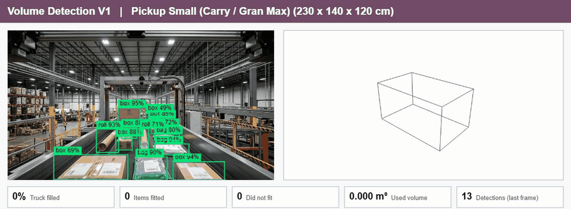
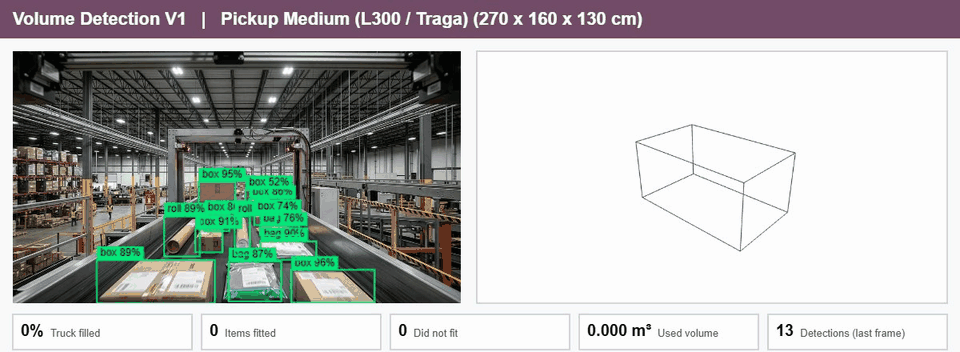
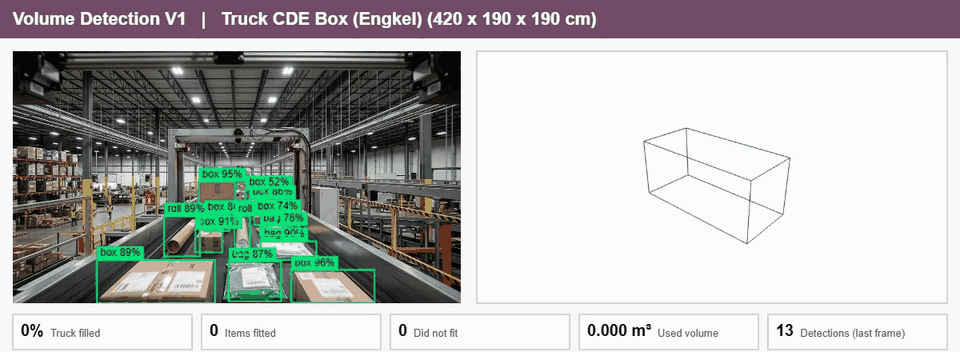

# Volume Vision (V1)

**Watch a video of items on a belt, measure each item, and load them into a truck, from empty to full.**
Volume Vision is an Odoo 20 addon. It detects boxes, rolls and bags in a video, estimates the volume of each one, stacks them into the truck you choose, and shows the result in a simple 3D view where every item has an ID.

**Version:** V1 &nbsp;|&nbsp; **Odoo:** 20 &nbsp;|&nbsp; **License:** LGPL-3 &nbsp;|&nbsp; **Runs locally, no API key, no cloud, free**

---

## Demo

The same 8-second video, loaded into three different trucks. In every GIF the left side is the video with live detection boxes, the right side is the truck being filled in 3D (each box carries its `#ID`), and the numbers at the bottom update as items are counted.

### Pickup Small (230 x 140 x 120 cm)


The smallest truck fills fastest. Items stack up in layers because there is not enough floor. **29 items, 15.6% full.**

### Pickup Medium (270 x 160 x 130 cm)


More floor and height, so the same 29 items spread out into a wide, low load. **29 items, 10.7% full.**

### Truck CDE Box / Engkel (420 x 190 x 190 cm)


A medium truck. The load is only a thin layer at the front, which shows how much room is left. **29 items, 4.0% full.**

> The item count is the same in all three because it is the same video. Only the truck changes, so the fill percentage and the arrangement change.

---

## What it does

- **Detects items in video.** A small YOLOv8 model (box, roll, bag) runs on your own server. Boxes follow the video frame by frame.
- **Counts each item once.** A tracker follows items between frames. An item is counted after it has been seen four times in a row, so a detection that flickers for a moment is ignored.
- **Estimates volume.** Irregular items are treated as boxes. The footprint comes from the detection box and a scale (pixels per cm). The height is a default you can change. If you know the real size of a class, you can set a fixed length, width and height for it.
- **Loads the truck like a person would.** Items go to the lowest free spot nearest the front wall, slide tight against their neighbours, and stack when the floor is full. An item needs at least 70% of its base resting on the floor or on boxes below, so nothing floats. Items can turn 90 degrees on the floor.
- **Shows where each item went.** The 3D view labels every item with its `#ID`. The table lists the same IDs with their size and `x, y, z` position. Hover a row to light up that item in 3D.
- **Knows when the truck is full.** A run ends when an item that would fit in an empty truck has no room left. An item bigger than the truck itself (usually a measuring error) is only marked "Does not fit" and does not end the run.
- **Ready-made trucks.** Pickup Small, Pickup Medium, Pickup Double Cabin, Blind Van, CDE, CDD, Fuso, Tronton, Container 20 ft and 40 ft. Sizes are typical values, so edit them to match your vehicles.

## How it works

1. **Analyze once.** When you open the page, the server runs the detector on every frame of the selected video and keeps the result in memory (about 17 to 19 seconds for one 8-second clip).
2. **Play and draw.** While the video plays, the browser draws the boxes of the exact frame on screen (`requestVideoFrameCallback`), so they stay in sync with the picture.
3. **Count.** Every 0.25 seconds of video time, those boxes go through the tracker. This happens on the video's own clock, so the same video always gives the same count.
4. **Size and pack.** New items get a size, then the packer places them in the truck.
5. **Show.** The page updates the table, the numbers and the 3D view.

---

## Install

You need Odoo 20 (Community is enough) and these Python packages:

```bash
pip install opencv-python-headless numpy requests
```

```bash
git clone https://github.com/LukmanZak/volume-vision.git
# Add the cloned folder to Odoo's addons path, then install the module:
./odoo-bin -d <your_db> --addons-path=<odoo addons>,<path>/volume-vision -i volume_logistic_detection
```

Using Docker? Mount the cloned folder into the container's extra addons path (for example `/mnt/extra-addons`) and restart Odoo. Then open **Apps**, update the apps list, and install **Volume Detection**.

**Use it:** open **Volume Detection > Detect**, pick a truck and a video, and press **Start detection**. The first Start for a video waits a few seconds if its analysis is not finished yet.

The folder must keep the name `volume_logistic_detection`. Odoo uses the folder name as the module name.

### Settings

| Where | What |
| --- | --- |
| **Volume Detection > Configuration > Truck Boxes** | Add or edit trucks (length, width, height in cm). |
| **Volume Detection > Configuration > Item Classes** | Set a color per class, and an optional fixed size. |
| **Settings > Volume Detection** | Minimum confidence (default 0.4). The Roboflow fields are optional, see below. |
| **Detect page** | Scale in pixels per cm (default 3) and default item height in cm (default 20). |

To use the optional Roboflow cloud model instead of the bundled one, set the system parameter `volume_logistic_detection.detector` to `roboflow` and fill in the Roboflow fields in Settings. The API key is stored on the server and never sent to the browser. The default needs none of this.

---

## Cost and resources (running locally)

Everything V1 needs to run on your own computer is **free**.

| Part | Used for | Cost |
| --- | --- | --- |
| Odoo Community 20 | Hosts the addon | **Free** |
| PostgreSQL | Odoo's database | **Free** |
| OpenCV, NumPy, requests | Running the detector | **Free** |
| Three.js (bundled) | 3D view | **Free** |
| Detector model (bundled ONNX, 12 MB) | Finding the items | **Free**, no API key, no internet needed while using it |
| Docker Desktop (optional) | Running Odoo in containers | **Free** for personal use and small businesses |
| GPU | Not needed | CPU only |
| Roboflow hosted API (optional) | Cloud detection instead of the bundled model | Has a free plan. Prices change, so see roboflow.com/pricing. Not used by default. |
| Retraining the model (optional) | Making your own detector | **Free** software, about 72 minutes on a 12-core CPU for 300 epochs |

**Measured on the author's machine** (Windows 11, Docker, 12 CPU cores, no GPU):

| What | Result |
| --- | --- |
| Odoo container memory | about 0.5 GB |
| Detector speed | about 90 to 100 ms per frame |
| Analyzing one 8-second, 24 fps video (192 frames) | 17 to 19 seconds, once per video |
| Playback | Smooth, one set of boxes per video frame (about 24 fps) |
| Training the model from scratch | 300 epochs in about 72 minutes on CPU |
| Unit tests | 57 tests, all passing |

Your numbers will differ with your hardware.

---

## About the detector model

- A YOLOv8n model trained from scratch on **36 frames** taken from the two sample videos. It knows three classes: `box`, `roll` and `bag`.
- The training boxes were made automatically with the OWLv2 zero-shot model and were **not reviewed by hand**. Some boxes merge neighbouring items.
- Validation mAP50 was about 0.89 to 0.95, but the validation frames look very much like the training frames, so this number is **optimistic**. Expect weaker results on very different videos.
- The model is exported to ONNX and run with OpenCV inside Odoo. Training used Ultralytics (AGPL-3.0), which is **not needed** to run the addon.

## Known limits (V1)

- **Item height is a guess.** A single camera cannot measure height, so every item uses the default height (20 cm) unless its class has a fixed size.
- **The scale is not calibrated.** 3 px per cm is a rough value that suits the sample videos. Set the right value for your camera.
- **Counts are estimates.** There is no hand-counted ground truth for the sample videos.
- **Sample videos only.** Analysis works for the videos in `volume_logistic_detection/asset/`. Other footage can be added there, but the model was trained on the samples.
- **The analysis cache lives in memory.** It is rebuilt after an Odoo restart.
- **Items can only turn on the floor.** They are not tipped on their side.

## Roadmap (V2 and later)

- Calibrate the scale from a reference object in the picture.
- Item height from a class standard or a second camera.
- Upload your own videos, and live camera input.
- Review and fix training labels, then retrain on more footage.
- Run the detector in the browser for live streams.
- Weight and maximum load per truck.
- Heavy items at the bottom, fragile items on top.

---

## Tests

```bash
./odoo-bin -d <your_db> -u volume_logistic_detection \
    --test-tags /volume_logistic_detection --stop-after-init \
    --limit-memory-hard=0 --limit-memory-soft=0
```

The memory flags avoid a `MemoryError` that Odoo can raise while it builds its asset bundles during a test run. The tests cover the packer (no overlap, no floating items, earlier items never move), the tracker, volume estimation, the detector's output decoding, the preset trucks, and the server routes.

## Project layout

```
volume-vision/
  README.md
  LICENSE
  docs/gifs/                      demo GIFs
  volume_logistic_detection/      the Odoo addon
    controllers/main.py           routes: analyze, track_frame, detect_frame, sessions
    data/                         preset trucks and item classes
    detector/                     bundled ONNX model and class list
    models/                       trucks, item classes, sessions
    utils/                        packer, tracker, volume estimate, local detector
    static/                       OWL page, 3D view (Three.js), styles
    tests/                        unit and route tests
    asset/                        two sample videos
```

## License

LGPL-3, as declared in the addon's manifest. See `LICENSE`.
